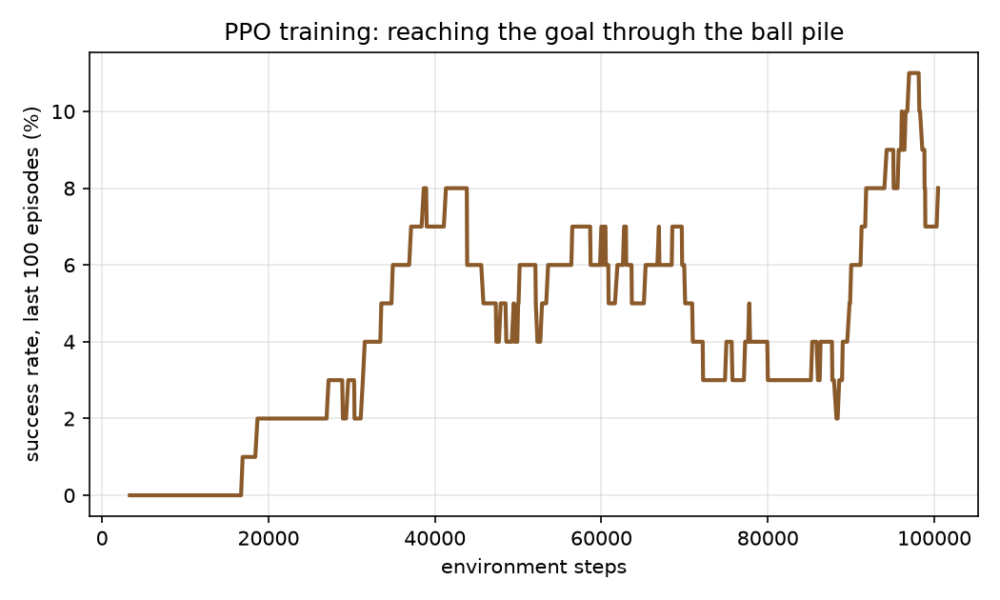
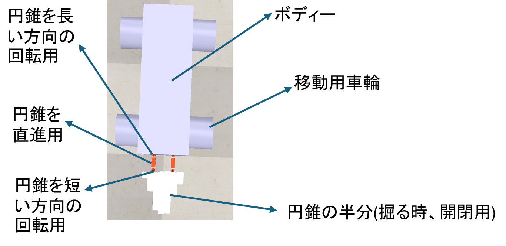
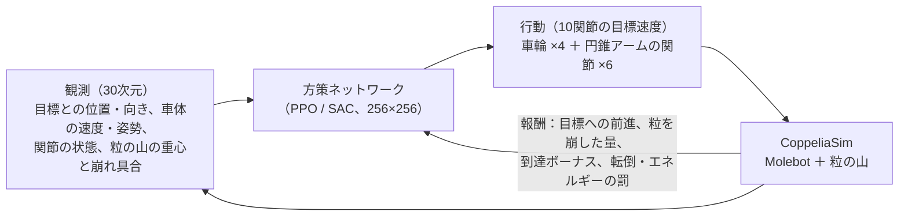

# molebot-rl

**モグラの掘り方をまねた自作ロボット「Molebot」に、強化学習で“粒の山を掘り進んで目標へ着く”動きを学ばせる研究です。危険な地下・トンネル作業をロボットに任せることを目指しています。**

**PPO で 100,450 ステップ学習し、目標到達率が学習初期 1.1% → 終盤 8.0% に上昇（871 エピソード中 43 回到達）**



| | |
|---|---|
| **課題** | 粒状の地面では、少しの動きの違いで粒同士・粒とロボットの接触が大きく変わり、決まったルールだけでは掘り進めない。トンネル作業は人には危険（崩落・酸欠・重労働） |
| **工夫** | **生物（モグラ）の掘り方をロボット設計に借用**：円錐アームで土を刺し、左右に押し広げ、戻すのをくり返す。4輪＋円錐アーム2本（計10関節）を自分で設計し、強化学習で協調させる |
| **成果** | CoppeliaSim 上で SAC と PPO を比較。SAC はアームの動きにこだわって前進できなかったが、PPO は粒の山を越えて目標へ到達する方策を学習（到達率 1.1% → 8.0%） |

---

## モグラの「刺す・押し広げる・戻す」をロボットの構造にした





- **タスク**：開始位置の前方 2.5 m、半径 0.25 m の目標に、粒の山を越えて到達する。
- **円錐アーム**：回転・直動・円錐の回転の関節を持ち、円錐で粒を刺して押し広げる（円錐は粒と実際に接触する）。
- **安定化**：車輪とアームの最大速度・力を制限し、行動の急な変化を平滑化して、物理計算の破綻を防いだ。

## SAC の失敗から学び、PPO で到達できる方策を得た

| アルゴリズム | 結果 | 分かったこと |
|---|---|---|
| SAC | アームの動きにこだわりすぎて前進できない | 良い行動が偶然見つかりにくい課題では、確率的な探索だけでは足りない |
| **PPO**（6並列） | 100,450 ステップ・871 エピソードで 43 回到達。到達率 1.1% → 8.0% | 前進を学びながら、粒の山を越える行動が少しずつ増えた |

出典：[`results/ppo_cross_easy/`](results/ppo_cross_easy/)（Stable-Baselines3 の Monitor ログと学習済みモデル）。図は [`docs/make_figure.py`](docs/make_figure.py) で再生成できます。

## 構成と技術

| 項目 | 内容 |
|---|---|
| シミュレータ | CoppeliaSim Edu 4.10（ZeroMQ リモート API、ヘッドレスで並列実行） |
| 強化学習 | Stable-Baselines3（PPO / SAC / TD3）、Gymnasium |
| 主なファイル | `molebot_env.py`（環境・報酬）、`train.py`（学習）、`evaluate.py`（評価）、`config.py`（設定）、`scene/molebot.ttt`（ロボットと粒の山） |
| 階層型の試み | `controller.py`・`hierarchical_env.py`：移動と掘削を別の方策に分け、動作プリミティブ（刺す・どける・戻す）を選ばせる |

### 実行方法

```bash
powershell -ExecutionPolicy Bypass -File setup_env.ps1   # conda 環境 "molebot" を作成
conda activate molebot
python train.py --algo ppo --task cross --timesteps 100000
python evaluate.py --model results/ppo_cross_easy/ppo_final.zip --episodes 5
```

CoppeliaSim のインストール先が違う場合は環境変数 `COPPELIASIM_EXE` を設定してください（`.env.example`）。

## 限界：到達率はまだ低く、評価も1シード

- 学習中の到達率は最大でも 1 割未満。学習は 1 シードのみ。
- 決定論的な評価の到達率は、別途ログを保存して再確認中。
  <!-- TODO(Jason): evaluate.py の出力を保存し、評価の到達率を出典つきで追記 -->

## 今後：アームの動きを段階的に教え、移動と掘削を分けて学ばせる

- 初期はアームの動きを制限し、前進を覚えてから掘削を加える（カリキュラム）。
- 移動と掘削を分けた階層型の方策を完成させる。

---

## English

**A mole-inspired robot I designed, "Molebot", learns with reinforcement learning to dig through a pile of grains and reach a goal, aiming to hand dangerous underground and tunnel work to robots.**

**PPO, 100,450 steps: the goal-reaching rate rose from 1.1% early in training to 8.0% at the end (43 of 871 episodes reached the goal).**

| | |
|---|---|
| **Problem** | On granular ground, tiny differences in motion change the grain-grain and grain-robot contacts a lot, so fixed rules cannot dig through. Tunnel work is dangerous for people. |
| **Idea** | **Borrowed from biology (how moles dig):** cone arms stab the soil, push it aside and retract, repeatedly. I designed a 4-wheel body with two cone arms (10 joints) and let RL coordinate them. |
| **Result** | SAC vs PPO in CoppeliaSim. SAC got stuck moving its arms; PPO learned to cross the grain pile to the goal (1.1% → 8.0%). |

**Setup.** Goal 2.5 m ahead (radius 0.25 m). Observation: 30 values (goal direction and distance, body velocity and attitude, joint states, grain-pile centre and disturbance). Action: target velocities of 10 joints. Reward: progress, disturbed grains, goal bonus, penalties for tipping and energy.

**Run.** `setup_env.ps1` creates the conda env; then `python train.py --algo ppo --task cross` and `python evaluate.py --model results/ppo_cross_easy/ppo_final.zip`. Logs and the trained model are in `results/ppo_cross_easy/`.

**Limitations.** The success rate is still below 10%, with one seed. A saved deterministic evaluation is still to be added.

**Next.** A curriculum (restrict the arms first) and a hierarchical policy (separate driving and digging).
